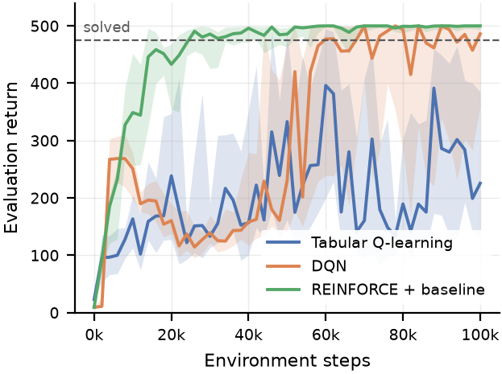

# A Comparative Study of Value-Based and Policy-Based Reinforcement Learning on CartPole-v1

An empirical comparison of three reinforcement learning methods on `CartPole-v1`
(Gymnasium). The three methods sit at three levels of approximation:

| Method | Representation | Source |
| --- | --- | --- |
| Tabular Q-learning | Exact value table over a binned state space | Watkins & Dayan, 1992 |
| DQN | Neural value function, replay buffer, target network | Mnih et al., 2015 |
| REINFORCE with baseline | Direct policy, learned state-value baseline | Williams, 1992 |

The paper does not rank the methods. All three solve CartPole, so the question is
what each one **costs**: environment samples, computation, reliability across
seeds, and implementation effort.



## Headline result

Interquartile mean over 10 seeds, identical budget of 100,000 environment steps:

| Method | Steps to solve | Final return (IQM) | Wall clock | Gradient updates | Failed seeds | LoC / hyperparams |
| --- | --- | --- | --- | --- | --- | --- |
| Tabular Q-learning | 36k | 226 [133, 390] | **16 s** | 100,000 | 10% | 87 / 7 |
| DQN | 55k | 486 [354, 500] | 180 s | 99,001 | 0% | 136 / 12 |
| REINFORCE + baseline | **18k** | **500** [493, 500] | 39 s | **470** | 0% | 113 / **6** |

The 27 October 2026 rerun reproduced the headline learning statistics with the
locked dependencies. These wall-clock means include evaluation and come from
eight concurrent workers on an AMD Ryzen 7 8845HS running Windows 11.

The orderings disagree, which is the point. REINFORCE reaches the threshold first
and ends at the maximum return using two orders of magnitude fewer gradient
updates than DQN. Tabular Q-learning is the fastest to run and the least
reliable. Every seed produces an individual evaluation episode scoring 500, but
none ends with a mean evaluation return of 500,
because the discretisation its exact representation demands makes distinct states
indistinguishable. Removing DQN's target network collapses it to a return of 9;
removing REINFORCE's baseline costs it 139 return but it still learns.

## Deliverables

- `paper/paper.pdf` — the research paper (IEEE two-column)
- `rlcompare/` — the complete implementation
- `results/` — every raw run: an evaluation-curve CSV and a config/metrics JSON

Run `uv run python package_submission.py` after the experiments and PDF build to
create `submission/rl-cartpole-comparison.zip` with all three deliverables.
The raw results and submission archive are tracked in Git, so a clone includes
the experiment data as well as the code and paper.

## Requirements

- [`uv`](https://docs.astral.sh/uv/) (installs Python 3.12 and every dependency)
- [Tectonic](https://tectonic-typesetting.github.io/) — only to rebuild the PDF

No GPU is needed. CPU-only PyTorch is used deliberately: the networks are small
enough that moving data to a GPU costs more than the computation saves.

## Reproduce everything

```bash
uv sync --extra dev          # create .venv from the committed uv.lock
uv run python run.py all     # tune, run the matrix, regenerate figures and tables
cd paper && tectonic -X compile paper.tex
```

`run.py all` takes roughly 1–2 hours on 12 cores. It is safe to interrupt: every
run is named by a hash of its configuration, so restarting skips whatever already
finished.

## Run the stages separately

```bash
uv run python run.py tune       # equal-budget random search -> configs/tuned.yaml
uv run python run.py matrix     # main comparison, sweeps, ablations
uv run python run.py analyse    # figures and tables into paper/
```

Single run, for debugging:

```bash
uv run python run.py single --method dqn --seed 0 --steps 20000
```

Adjust parallelism with `--workers N` (default 12).

## Show live training

```bash
uv run python run.py demo
```

The command opens a local browser at `http://127.0.0.1:8765`. Select an algorithm,
seed, and step budget, then choose **Reset with these settings** and **Start
training**. The cart and pole show actual Gymnasium observations while the
project's agents learn with the tuned study parameters.

Use **Fast** or **Turbo** to train between displayed frames. Use **Real time** to
show every environment step. **Pause** stops after the current bounded batch.
**Evaluate policy** pauses learning, tests ten fixed evaluation seeds without
exploration, and animates the first episode. Its mean return appears separately
from training episode returns. Resume training when the evaluation finishes.

For a presentation, start with REINFORCE, train in Turbo, pause after several
thousand steps, and evaluate the policy. Repeat later to show how its behavior
changes. A single seed need not improve steadily or solve within a short demo.
The paper's aggregate results remain the comparison across ten seeds.

The demo runs offline, requires no extra packages, and keeps its session in
memory. Reset discards the live agent. It does not write into `results/` or change
the paper. One session is shared by local browser tabs. To choose a different
port or open the page yourself, run:

```bash
uv run python run.py demo --port 8766 --no-browser
```

Press Ctrl+C in the terminal to stop the server.

## Tests

```bash
uv run pytest
```

If Node.js is available, run `node tests/test_demo_ui.cjs` to check evaluation
playback when you pause or hide the browser during a request.

The suite is small on purpose. It does not chase coverage; it targets the places
where a mistake would be **silent** — a sign error in the advantage or an
off-by-one in the discounted return does not crash, it produces a plausible
learning curve and a wrong paper. It checks the discounted returns, the state
discretiser's clipping, the replay buffer under overwrite, the aggregation
statistics, and that every method reproduces its curve exactly from a fixed seed.

## Layout

```
configs/study.yaml     the complete study design: budget, seeds, sweeps, ablations
configs/tuned.yaml     hyperparameters chosen by the search (generated)
rlcompare/agents/      one module per method, plus the shared agent interface
rlcompare/experiments/ config schema, the single training loop, the run matrix
rlcompare/analysis/    IQM/bootstrap statistics, figures, tables
paper/                 LaTeX source; figures/ and tables/ are generated
results/               raw run output, grouped by tuning/main/sweep/ablation
tests/                 the silent-failure checks
```

## Design notes

**One training loop.** All three agents implement the same four-operation
interface, so the loop, the evaluation procedure and the logging are written once
and shared. No method can gain an advantage from the harness.

**Equal budgets.** Every run gets exactly 100,000 environment steps, and curves
are plotted against steps rather than episodes — an episode is ~20 steps for an
untrained policy and 500 for a good one, so an episode budget would silently give
the better method far more data.

**Held-out evaluation.** Training is paused every 2,000 steps and the agent is
evaluated for 10 episodes with exploration disabled, on a fixed set of
environment seeds identical across every method and run.

**Equal tuning budgets.** Each method gets the same number of random-search
trials, scored on tuning seeds that are disjoint from the evaluation seeds.

**Robust statistics.** Results across seeds are skewed and often bimodal, so the
point estimate is the interquartile mean with a bootstrap interval over seeds,
not the mean and standard deviation.

**Generated numbers.** Every figure, table, and quoted number in the paper is
produced from the raw results, so the prose cannot drift out of step with the
data.

## Changing the study

Edit `configs/study.yaml` — the budget, the seeds, the search spaces, the sweep
values and the ablations all live there. Nothing about the experiment design is
hard-coded in Python.
